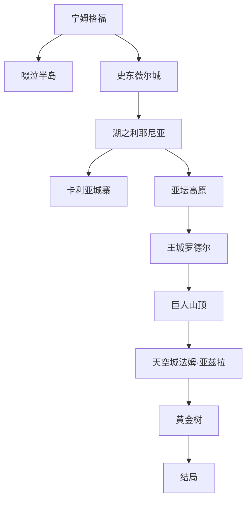

# 🌋 Elden Ring 主线流程完整攻略

> **献给褪色者们** — 从宁姆格福到黄金树，最完整的主线路线指南


<div style="padding: 1rem; background: var(--vp-c-bg-soft); border-radius: 12px; margin-bottom: 1.5rem; display: flex; flex-wrap: wrap; gap: 1rem; font-size: 0.85rem;">

| 基本信息 | |
|----------|---|
| 🎮 游戏 | Elden Ring / 艾尔登法环 |
| ⚔️ 类型 | ARPG · 开放世界 |
| 📅 版本 | 1.12 (黄金树幽影 DLC) |
| 🔥 难度 | 困难 |
| ⏱️ 主线时长 | 约 40-60 小时 |
| 🏆 全收集 | 约 100+ 小时 |

</div>

## 📋 版本说明

当前攻略基于 **1.12 版本（黄金树幽影）** 编写，包含 DLC 新增内容。版本更新可能导致部分机制和数值变化。

## 🗺️ 主线流程概览



## 一、宁姆格福 — 新手区域

### 1.1 开局建议

<div class="spoiler-block">

**职业选择推荐（新手向）**：
1. **流浪骑士** — 最均衡，自带 100% 物防盾
2. **武士** — 高敏捷，初始武器强力
3. **预言家** — 初期有治疗魔法，容错率高

**关键路线**：
1. ❗ 先到 **关卡前方** 赐福点激活梅琳娜
2. 🎯 等级达到 20+ 再挑战 **恶兆妖鬼**
3. 💡 向南前往 **啜泣半岛** 刷魂和收集圣杯露滴

</div>

### 1.2 重要道具位置

| 道具 | 区域 | 用途 |
|------|------|------|
| 🛡️ 金黄铁盾 | 关卡前方附近 | 100% 物理减伤 |
| 📖 战灰：鲜血斩击 | 亚基尔湖北方废墟 | 前期强力战技 |
| 🧪 圣杯露滴 ×5 | 各地小教堂 | 提升元素瓶回复量 |
| 🗺️ 地图碎片 | 各区域石碑 | 解锁地图 |

## 二、史东薇尔城

### 2.1 主线路线

```
关卡前方 → 史东薇尔正门（或侧门潜行）→ 城墙塔 → 
升降机旁小路 → 接肢葛瑞克 → 获得大卢恩
```

### 2.2 BOSS 战：接肢葛瑞克

**推荐等级**：30-40
**弱点**：⚡ 雷属性
**逃课打法**：

1. 召唤 **涅斐丽·露**（雾门前金色 summon sign）
2. 使用 **离群野狼** 灵魂召唤
3. 保持中距离，等他使用跳劈后翻滚背刺
4. P2 龙头攻击时向侧前方翻滚

<div class="spoiler-block">

**💡 隐藏路径**：史东薇尔城底层有一个隐藏升降机通往 **深根底层**，需要击败 **熔炉骑士** 获取钥匙。

</div>

## 三、湖之利耶尼亚

### 3.1 关键路线

```
利耶尼亚大道 → 四钟楼 → 卡利亚城寨 → 
书斋 → 迪可达斯大升降机 → 亚坛高原
```

### 3.2 魔法教授推荐

| 法术 | 需求 | 获取位置 | 评价 |
|------|------|----------|------|
| 岩石球 | 18 智力 | 瑟利亚魔法镇 | ⭐⭐⭐⭐⭐ |
| 辉石魔砾 | 14 智力 | 魔法学院 | ⭐⭐⭐⭐ |
| 古老死亡怨魂 | 24 智力 | 神皮使徒掉落 | ⭐⭐⭐ |

## 四、王城罗德尔

### 4.1 BOSS 战配置参考

| BOSS | 推荐等级 | 推荐武器 | 特殊机制 |
|------|----------|----------|----------|
| “恶兆王”蒙葛特 | 70+ | +15 以上 | 二阶段范围攻击增多 |
| 初始之王葛孚雷 | 90+ | +20 以上 | 老将阶段霸体增强 |
| 拉达冈 / 艾尔登之兽 | 100+ | +25 | 连续战斗，注意耐力管理 |

## 五、结局选择

| 结局 | 触发条件 | 说明 |
|------|----------|------|
| ⚡ 衰颓时代 | 默认 | 无特殊条件 |
| 🌙 星星时代 | 完成菈妮支线 | 最佳结局，最完整剧情 |
| 🔥 癫火之王 | 接受三指赐福 | 最黑暗结局，梅琳娜离队 |
| 💀 潜藏者结局 | 完成菲雅支线 | 命定之死修复 |

## 六、避坑提示 🚨

1. ❌ **不要恶意攻击 NPC** — 赎罪需要消耗道具
2. ❌ **别在火山官邸提前击杀拉卡德** — 会锁掉重要支线
3. ❌ **注意陷阱宝箱** — 会被传送到高级区域
4. ⚠️ **出血流在后期依然强势** — 双曲剑跳劈是版本答案

## 七、配装推荐

### 近战物理流

```
右手: 粉碎巨人锤 +25 / 战灰：狮子斩
左手: 金黄铁盾 +25 / 指纹石盾
护甲: 大山羊套装（最高韧性）
护符: 大壶众武护符 + 绿龟护符 + 斧护符 + 龙徽大盾护符
```

### 法师流

```
右手: 暗月大剑 +10 / 卢瑟特的辉石杖 +10
左手: 卡利亚辉剑杖 +10 / 黄铜盾
护符: 拉达冈的肖像 + 魔法师块护符 + 魔力对蝎 + 绿龟护符
```

---

<style>
/* Game section specific styling for this page */
.vp-doc h2 { margin-top: 2.5rem; padding-top: 0.5rem; border-top: 3px solid var(--vp-c-brand-2); }
.vp-doc h3 { margin-top: 1.5rem; }
</style>

<RelatedContent />
